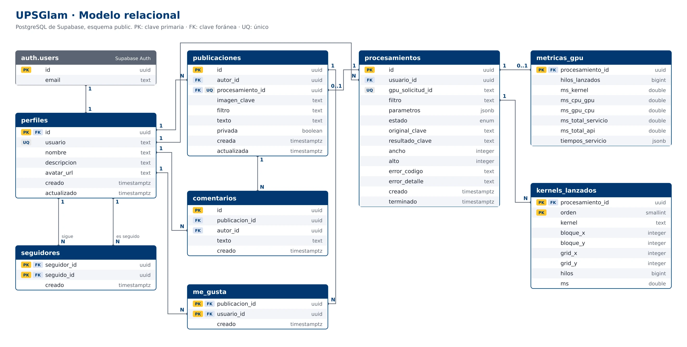

# Base de datos y Supabase

## 1. Propósito y alcance

UPSGlam utiliza Supabase como servicio externo para tres funciones: **Auth** (registro,
inicio y cierre de sesión con correo y contraseña), **PostgreSQL** (modelo relacional) y
**Storage** (imágenes originales, resultados y avatares). Supabase no se ejecuta en
contenedores.

La configuración reproducible se encuentra en [`infra/supabase/`](../../infra/supabase/):

```
infra/supabase/
├── .env.example      plantilla de variables, sin valores reales
├── .gitignore        excluye .env del repositorio
└── migrations/       SQL versionado, aplicado en orden
```

Ante una contradicción entre fuentes, el orden de prioridad es el siguiente:

1. El enunciado del proyecto y su rúbrica.
2. Este documento.
3. Las reglas del frontend (`docs/frontend/reglas/`).

## 2. Proyecto y credenciales

| Opción | Valor | Motivo |
|---|---|---|
| Plan | Free | La rúbrica no exige infraestructura de pago |
| Región | East US (North Virginia) | Menor latencia habitual desde Ecuador frente a São Paulo |
| Claves de API | `sb_publishable_…` y `sb_secret_…` | Claves vigentes; las heredadas (`anon`, `service_role`) no se utilizan |
| Firma de tokens | ECC P-256 (ES256) | El backend valida los tokens con la llave pública, sin secreto compartido |
| Conexión a la base | Session pooler (IPv4) | La conexión directa solo admite IPv6 |

### Ubicación de cada credencial

| Variable | Origen en el panel | App | Backend |
|---|---|---|---|
| `SUPABASE_URL` | *Project Settings → Data API* | Sí | Sí |
| `SUPABASE_PUBLISHABLE_KEY` | *Project Settings → API Keys* | Sí | Sí |
| `SUPABASE_SECRET_KEY` | *Project Settings → API Keys → Secret keys* | No | Sí |
| `DB_R2DBC_URL`, `DB_USUARIO` | *Connect → Connection string → Session pooler → Connection parameters* | No | Sí |
| `DB_CLAVE` | Contraseña definida al crear el proyecto | No | Sí |
| `SUPABASE_JWT_ISSUER`, `SUPABASE_JWKS_URL` | Se forman con el identificador del proyecto | No | Sí |

- Los valores reales se guardan en `infra/supabase/.env`, excluido del control de versiones.
  La plantilla es [`.env.example`](../../infra/supabase/.env.example).
- `DB_R2DBC_URL` se compone con el host, el puerto y la base del pooler:
  `r2dbc:postgresql://HOST:5432/postgres?sslMode=require`.
- La aplicación móvil recibe la URL y la clave pública al construir la APK mediante
  `--dart-define` ([regla 07](../frontend/reglas/07-sesion-y-token.md)). La clave secreta y
  las credenciales de la base nunca forman parte de la APK.

## 3. Modelo relacional

Migración: [`20261126120000_esquema.sql`](../../infra/supabase/migrations/20261126120000_esquema.sql).



### Decisiones de diseño

- **Historial completo.** Se registra cada solicitud enviada al servicio de GPU, se publique
  o no, con su estado y su error. La base exige coherencia: una solicitud en `aplicando` no
  tiene fecha de fin, una en `lista` tiene resultado y una en `fallo` tiene código de error.
- **Métricas no disponibles.** `metricas_gpu` solo contiene una fila cuando la solicitud llegó
  a lanzar kernels. Si falló antes, la fila no existe y no se registran valores ficticios.
- **Un kernel por fila.** `kernels_lanzados` almacena cada lanzamiento en su orden real: el
  Laplaciano lanza dos `convolucion_gris` y el efecto UPS lanza `sobel` y después
  `colorear_ups`. Esto permite consultar con SQL el tiempo de cada kernel según la
  resolución. Los kernels se lanzan en dos dimensiones, con un hilo por píxel, por lo que no
  se registra `bloque_z`. La base verifica que `hilos = bloque_x × bloque_y × grid_x × grid_y`.
- **Tiempos fuera de la GPU.** El desglose del servicio (decodificación, cola, GPU y
  codificación) se conserva en `tiempos_servicio` (JSON), sin columnas propias. El tiempo
  fuera de la GPU se obtiene por diferencia: `ms_total_api` − `ms_kernel` − copias.
- **Filtros.** Los seis filtros y los cuatro kernels se validan con restricciones `check`; no
  existe una tabla de filtros.
- **Usuario y correo.** El `usuario` es único sin distinguir mayúsculas y no puede
  modificarse. El correo no se duplica en `perfiles`: reside en `auth.users` y el backend lo
  incluye solo en el perfil propio.
- **Contadores.** Los me gusta, comentarios, seguidores y publicaciones se calculan en cada
  consulta; no se almacenan.
- **Paginación por cursor.** Índices por (fecha, id) descendente para Inicio (solo
  publicaciones públicas), publicaciones de un usuario, historial y seguidores; ascendente
  para comentarios.
- **Eliminación.** Al eliminar una cuenta se eliminan en cascada todos sus datos. Si se
  elimina un procesamiento publicado, la publicación se conserva con su `imagen_clave` y
  pierde únicamente el enlace al procesamiento.

### Correspondencia con el servicio de GPU

Respuesta de `POST /api/procesar` ([servicio-gpu.md §7.1](../backend/servicio-gpu.md)):

| Campo de la respuesta | Columna |
|---|---|
| `id` | `procesamientos.gpu_solicitud_id` |
| `parametros`, `ancho`, `alto` | `procesamientos.parametros`, `ancho`, `alto` |
| `metricas.hilos_lanzados`, `ms_kernel`, `ms_cpu_gpu`, `ms_gpu_cpu` | `metricas_gpu`, columnas homónimas |
| `tiempos_ms.total` | `metricas_gpu.ms_total_servicio` |
| `tiempos_ms` completo | `metricas_gpu.tiempos_servicio` |
| `metricas.kernels[i]` | `kernels_lanzados`: `orden = i + 1`, `bloque[0..1]`, `grid[0..1]`, `hilos`, `ms` |
| Error: `error`, `detalle` | `procesamientos.error_codigo`, `error_detalle`, `estado = fallo` |

`ms_total_api` lo mide el backend desde la recepción de la imagen hasta la respuesta a la
aplicación.

## 4. Seguridad

Migraciones: [`20261126120100_perfil_al_registrarse.sql`](../../infra/supabase/migrations/20261126120100_perfil_al_registrarse.sql)
y [`20261126120200_politicas_rls.sql`](../../infra/supabase/migrations/20261126120200_politicas_rls.sql).

El contenido público puede leerse; cada usuario modifica únicamente lo propio; el contenido
privado solo es visible para su propietario. El control se aplica en dos capas:

1. **Backend.** Valida el token con `SUPABASE_JWKS_URL` y obtiene el usuario del claim `sub`.
   Toda modificación o eliminación incluye la condición de que el propietario sea el usuario
   del token; en caso contrario responde 403 o 404 sin alterar datos. El backend se conecta
   como `postgres`, propietario de las tablas, por lo que RLS no se le aplica y esta capa es
   obligatoria.
2. **Base de datos (RLS).** Protege el acceso directo con la clave pública. Sin sesión (rol
   `anon`) no es posible leer ninguna tabla.

| Tabla | Lectura | Creación | Modificación | Eliminación |
|---|---|---|---|---|
| perfiles | Usuarios con sesión | Trigger de registro | Perfil propio (nombre, descripción, avatar); el usuario no cambia | Junto con la cuenta |
| procesamientos, metricas_gpu, kernels_lanzados | Propietario | Backend | Backend | Backend |
| publicaciones | Públicas; privadas solo el autor | Autor | Autor | Autor |
| comentarios | En publicaciones visibles | Propio, en publicaciones visibles | No permitida | Autor del comentario o de la publicación |
| me_gusta | En publicaciones visibles | Propio | — | Propio |
| seguidores | Filas en que participa el usuario | Como seguidor | — | Como seguidor |

- La lista de seguidores solo es visible para su propietario. El número de seguidores y el
  indicador `loSigo` de otros perfiles los calcula el backend.
- **Usuario inmutable.** El trigger `perfiles_usuario_inmutable` rechaza cualquier cambio de
  `usuario`, sin importar su origen.
- **Registro.** La aplicación envía `nombre` y `usuario` en los metadatos de `signUp`. El
  trigger `al_registrarse_crear_perfil` crea el perfil; si falta un dato, no cumple su
  restricción o el usuario ya existe, la cuenta no se crea y Supabase devuelve un error
  genérico. Por ello el backend ofrece previamente la consulta
  `GET /usuarios/disponible?usuario=…` (ruta propuesta).
- **Tiempo real.** Los me gusta y comentarios se notifican mediante SSE desde el backend.
  Supabase Realtime no se utiliza.

## 5. Storage

Migración: [`20261126120300_storage.sql`](../../infra/supabase/migrations/20261126120300_storage.sql).

| Bucket | Acceso | Tamaño máximo | Formatos |
|---|---|---|---|
| `originales` | Privado | 25 MB (igual que el servicio de GPU) | JPG, PNG, WEBP |
| `resultados` | Privado | 50 MB (máximo del plan gratuito) | JPG |
| `avatares` | Público | 2 MB | JPG, PNG, WEBP |

```
originales/{usuario_id}/{procesamiento_id}.jpg|png|webp
resultados/{usuario_id}/{procesamiento_id}.jpg
avatares/{usuario_id}/{id_nuevo}.jpg|png|webp
```

- El mismo `procesamiento_id` vincula el original, el resultado y la fila del historial. La
  imagen de una publicación es su resultado; no se duplica.
- **Escritura.** Solo el backend sube y elimina archivos, con la clave secreta y sin
  sobrescritura. No existen políticas de escritura para la clave pública, de modo que ningún
  usuario puede sobrescribir ni eliminar imágenes ajenas.
- **Lectura.** Originales y resultados: URL firmada generada por el backend en cada consulta,
  con vigencia de una hora. Avatares: URL pública almacenada en `perfiles.avatar_url`; el
  nombre del archivo cambia con cada imagen nueva para evitar resultados en caché.
- La base almacena la ruta del archivo (`*_clave`) y no la URL firmada, porque esta caduca.
- La aplicación envía la fotografía en WEBP, con el lado mayor limitado a 2560 px y calidad
  85. El servidor acepta además JPG y PNG dentro de los límites del servicio de GPU.

### Archivos temporales y resultados fallidos

1. El backend recibe la imagen en memoria, sin archivos temporales en disco. Crea el
   procesamiento en estado `aplicando` y sube el original.
2. Invoca el servicio de GPU, que conserva el resultado durante `TTL_MIN` (10 minutos).
3. **Éxito:** descarga el resultado, lo sube a `resultados`, registra métricas y kernels y
   cambia el estado a `lista`.
4. **Fallo:** cambia el estado a `fallo` con el código del servicio. El original se conserva
   para que el historial muestre la imagen afectada; no hay resultado ni métricas.
5. **Limpieza:** al reemplazar un avatar se elimina el anterior; al eliminar un procesamiento
   o una cuenta, el backend elimina sus archivos, ya que Supabase no lo hace de forma
   automática.

### Límites del plan gratuito

| Límite | Valor | Se recupera al eliminar archivos |
|---|---|---|
| Tamaño por archivo | 50 MB | No aplica |
| Espacio total | 1 GB | Sí |
| Transferencia | 5 GB por mes | No; se restablece cada mes |

Con imágenes de 2560 px en WEBP, cada procesamiento ocupa aproximadamente 2 MB. Las pruebas
de carga utilizan una imagen representativa de tamaño moderado y sus datos se eliminan al
finalizar. Los valores vigentes pueden consultarse en *Usage*.

## 6. Auth

Configuración en *Authentication → Sign In / Providers → Email*:

| Opción | Valor |
|---|---|
| Allow new users to sign up | Activado |
| Allow anonymous sign-ins | Desactivado |
| Proveedores | Solo Email |
| Confirm email | Desactivado; el servicio de correo gratuito de Supabase solo envía a miembros de la organización |
| Minimum password length | 8 |
| Password requirements | Minúsculas, mayúsculas, dígitos y símbolos ([regla 06](../frontend/reglas/06-formularios.md)) |
| Prevent use of leaked passwords | Desactivado; disponible solo en el plan Pro |
| Magic links y OTP por correo | Desactivado |

Supabase exige esta política aun cuando la validación de la aplicación falle.

## 7. Aplicación de las migraciones

Las migraciones se aplican en orden y una sola vez en un proyecto nuevo:

1. `20261126120000_esquema.sql`
2. `20261126120100_perfil_al_registrarse.sql`
3. `20261126120200_politicas_rls.sql`
4. `20261126120300_storage.sql`

**Con psql** (método empleado el 2026-11-27), desde `infra/supabase/` y con el `.env`
completo. La ejecución es atómica: si una migración falla, no se aplica ninguna.

```bash
psql "host=HOST port=5432 dbname=postgres user=postgres.REF sslmode=require" \
  -v ON_ERROR_STOP=1 --single-transaction \
  -f migrations/20261126120000_esquema.sql \
  -f migrations/20261126120100_perfil_al_registrarse.sql \
  -f migrations/20261126120200_politicas_rls.sql \
  -f migrations/20261126120300_storage.sql
```

**Con el SQL Editor del panel:** cada archivo se ejecuta en el orden indicado.

**Con la Supabase CLI:** `supabase link --project-ref REF --workdir infra` y
`supabase db push --workdir infra`. La CLI registra las migraciones aplicadas; psql y el SQL
Editor no lo hacen, por lo que en un proyecto ya migrado no deben ejecutarse de nuevo.

Todo cambio posterior se incorpora en una migración nueva con fecha posterior; las
migraciones aplicadas no se modifican.

## 8. Integración con el backend WebFlux

**Base de datos (R2DBC):**

```yaml
spring:
  r2dbc:
    url: ${DB_R2DBC_URL}
    username: ${DB_USUARIO}
    password: ${DB_CLAVE}
```

El pooler de sesión asigna una conexión de PostgreSQL por cada conexión del pool, por lo que
el tamaño del pool de R2DBC debe mantenerse por debajo del límite de conexiones del plan.

**Validación de tokens (Spring Security, servidor de recursos JWT):**

```yaml
spring:
  security:
    oauth2:
      resourceserver:
        jwt:
          issuer-uri: ${SUPABASE_JWT_ISSUER}
          jwk-set-uri: ${SUPABASE_JWKS_URL}
```

El identificador del usuario es el claim `sub` y el rol esperado es `authenticated`.

**Storage (REST mediante `WebClient`),** con la clave secreta en la cabecera `apikey`:

| Operación | Petición |
|---|---|
| Subida | `POST {SUPABASE_URL}/storage/v1/object/{bucket}/{ruta}` con `x-upsert: false` |
| URL firmada | `POST {SUPABASE_URL}/storage/v1/object/sign/{bucket}/{ruta}` con `{"expiresIn": 3600}` |
| Eliminación | `DELETE {SUPABASE_URL}/storage/v1/object/{bucket}` con `{"prefixes": [rutas]}` |
| URL pública (avatares) | `{SUPABASE_URL}/storage/v1/object/public/avatares/{ruta}` |

Reglas para el backend:

- Toda modificación o eliminación se filtra por el propietario del token (sección 4).
- El correo del perfil propio se obtiene de `auth.users`.
- Las respuestas a la aplicación siguen los esquemas de la
  [regla 08](../frontend/reglas/08-datos-y-cache.md): `imagenUrl` firmada e `imagenClave`
  con la ruta del archivo.
